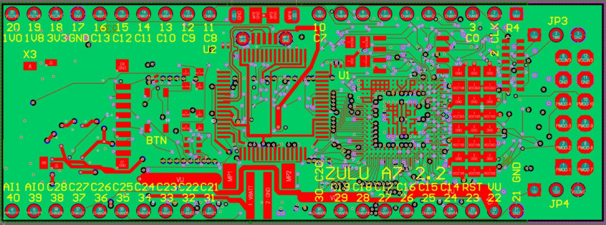

# Fab B Rev 2 layout (2026-11-11)

User request: X1 (micro-USB) sits between header pins 10 (CHAN7) and 11 (CHAN8), X4 (LiPo JST) between pins 30
(CHAN20) and 31 (CHAN21), X2 rearranged to match (each row 10 + 10 around a 12.70 mm landing centred on x 30.48).

## Schematic

Sheet 2 (`zulu_a7_2.SchDoc`): X2's MANF# is now `4x PRPC010SAAN-RC` (four 1x10 strips), with SPEC and the pin-field
NOTE rewritten for the 10 + 10 split (`tools/rev2_x2_sch.py`, parameter text only, netlist unchanged). The other sheet
edits of 2026-11-11 (USB5V0 wire, VBATT label, LTC3556 block diagram, LD3/LD4 notes) are the same as on Rev 1.

## What changed on the board

- X2 pads 10 and 30 moved 10.16 mm east to x 36.83; their top-silk labels moved with them; X1's designator hidden.
  Script `tools/FabB_Rev2Pads2.pas` (the first version, `FabB_Rev2Pads.pas`, refused and changed nothing: its test
  for the rotated '30 C20' label used the wrong box edge).
- X1 and X4 moved 2.54 mm west. X1's plated mounting holes then landed on Bottom parts: MH1 on U10 pad 6, MH2 on R84
  and R86. U10, R84 and R86 moved off them, and U10's new pad 1 then covered R96, so R96 moved too
  (`tools/route/rev2/place_u10d.py`, `place_search.py`; the search kept the new lands clear of OTHER nets' power copper):
  U10 (-1.30, -0.05), R96 (-0.96, +1.20), R84 and R86 (-1.70, +0.60). The moved parts' own VCC3V3/GND ties were ripped
  and re-laid by the reroute (among them the VCC3V3 via at (20.98, 18.74) that U10's moved pad 1 now covers).
- Copper: 138 tracks and 54 vias removed, 409 tracks and 94 vias placed (net +40 vias: 1921 -> 1961), by
  `tools/FabBCopper_Rev2.pas`, generated by `emit_copper.py` from `tools/route/rev2/final_emit.json`
  (= `final_plan_dedup.json` plus the six part moves of `prep/moves.json`).
- Fix-up after the first Altium DRC (2 violations, neither copper), `tools/FabBCopper_Rev2Fix.pas`:
  - R96 a further 0.06 mm west, because the Bottom mask sliver between R96-2 and U10-2 was 0.05 mm (rule 0.10; now
    0.11). Its EE-CLK jog moved with it, and a VCC3V3 track that overshot its via by 0.15 mm was trimmed to the via
    so R96-1 keeps its clearance. Generated by `emit_copper.py` from `route/rev2/delta_r96.json`; gated on
    `final_plan_r96.json` / `prep/base_moved_r96.json`.
  - The title 'ZULU A7 2.0' 0.2 mm east (37.5 -> 37.7), because its silk gap to the moved '30 C20' label was
    0.105 mm (rule 0.254). This block was added to the generated script BY HAND; it is not in delta_r96.json.
- 73 new laser vias marked as microvias (`mark_microvias.py --expect 1204`, 1204 verified), polygons repoured, saved
  ratsnest rebuilt (`FabB_RebuildConnR2.pas`: 0 connection objects; the save dropped 2 stale lines). DRC 23:24 0/0,
  saved 23:27 (md5 e8715917, title still 2.0; see Title below).

## Routing

Workflow fabb-rev2-reroute-v2 (`tools/route/rev2/E`, `F`, `G`, `H`; `A`-`D` are the earlier v1 run): all four v2
strategies closed every connection. The judge picked F (keep the old copper, minimal rip): fewest vias placed (F 94,
G 100, H 123, E 127); added track F 280 mm, G 281 (a near tie), H 321, E 398. Emitted from F's de-duplicated copy
(`route/rev2/final_plan_dedup.json`; the original lists 11 tiny connector tracks twice).

Gates, re-run independently before Altium and again after the R96 fix (all in the repo now: `tools/route_check.py`,
`tools/widthcheck.py`, `tools/prune_stubs.py`, `tools/route_conn.py`, and the judge in `tools/route/rev2/judge/`:
`judge.py` full-board exact DRC + via-in-pad audit, `planeweb.py`, `apply_plan.py`, `gate.sh`): route_check 0
violations / 0 open, width check 0, dead copper 0, route_conn 0 open, through vias on SMD pads 0, new microvias in
pads 0, full-board exact DRC 0 new findings against the unmoved board.

USB pair: Top only, 0.15/0.15, no vias, P 15.9223 / N 15.9224 mm on the board (mismatch 0.0002 mm), coupled 12.2 mm
at 0.01 mm tolerance (11.4 mm by strict parallel-segment overlap).

Power copper is narrower than Rev 1 in places (all pass the width rules): VU 0.6 mm through X4; VBATT's west run
0.4 mm over 9.6 mm (was 0.4-1.2); USB5V0 2.6 mm at 0.2 mm on Top near (32-34, 22.2); about 2.2 mm of 3 mil VCC3V3 on
Top between U2.20, U2.31 and a stacked plane-tie via at (34.9, 6.775) (legal: the VCC3V3 Width rule allows 3 mil on Top).

## Title (2026-11-12)

The silkscreen title is now 'ZULU A7 2.2' (`tools/FabB_Title22.pas`; same 1.3 mm size, stroke and place), so Rev 2 can
be told from Rev 1 ('ZULU A7 2.0') and from the no-PMOD board ('ZULU A7 2.1'). Only the top overlay changed: every
other Gerber and every drill file is identical to the 2026-11-11 export.

## Result

Altium DRC 2026-11-12 00:16 (after the title change): 0 violations, 0 warnings (`docs/drc_rev2.drc`). Board saved
00:16:55, md5 33023787, SHA-256 D77DE904... (the 2026-11-11 23:27 save with title 2.0 was md5 e8715917).

Library: the project's `zulu_a7.PcbLib` has no ZULU-DIP37 footprint (X2's footprint lives only on the board), so
there is no library pad to update.

The other files in `docs/` and the `tools/route/` stage folders other than `rev2/` are Rev 1 history copied with the
project.

## Release outputs (2026-11-11, title update 2026-11-12, PCBWay)

- Altium exports of the final board (md5 33023787, SHA-256 D77DE904...): 13 Gerbers and NC drills (G85 slots)
  re-exported 2026-11-12 00:17 after the title change, schematic PDF `Imported zulu_a7.PrjPcb/zulu_a7_fab_b_schematic.pdf` 23:38 (8 pages).
- Drills: 354 through (0.20), 403 buried L3-L4, microvias 321 / 307 / 281 / 295 (Top-L2 / L2-L3 / L4-L5 /
  L5-Bottom) = 1204; X1's plated slots now centred at (26.98, 23.96) and (33.98, 23.96).
- `fabrication/Zulu_A7_Fab_B_Rev_2_PCBWay_FAB_NOTES.txt` + `..._Fabrication_2026-11-11.zip` (23 entries) from
  `tools/fab_facts.py` + `tools/package_fabrication_release.py` (every board number re-measured for Rev 2; the
  packager now also checks the note's revision line, drill table, plug count and slot centres). Plug all 354 through
  vias; 68 via-in-pad sites (all microvias), 47 L2-L5 stacked sites. `tools/fab_facts_rev1.json` keeps Rev 1's report.
- `assembly/Zulu_A7_Fab_B_Rev_2_PCBWay_{BOM,CPL}.csv`, notes, top/bottom drawings and zip from
  `tools/generate_jlcpcb_assembly.py`: X2 is one BOM line, Qty 4 Sullins PRPC010SAAN-RC (was 2 x PRPC009 + 2 x
  PRPC011; `check_x2()` ties the BOM to the schematic MANF# and the board's pin runs); 68 purchase lines, 181 fitted
  parts; the CPL differs from Rev 1 only in X1, X4, U10, R96, R84 and R86.
- Both packages were rebuilt and checked against the board by an independent verifier (drill hits per span, slot
  coordinates, X2 pad flashes in GTL, CPL positions, BOM against the schematics, no order number).
- Known leftovers: the assembly notes' source line says the board was untracked when they were generated (the PCB
  SHA-256 line identifies it); `tools/bom_audit.py` still lists Rev 1's X2 strips.
