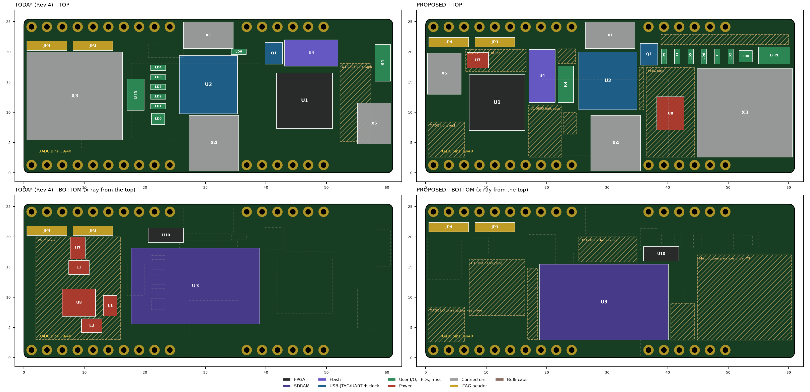

# Zulu_a7_no_pmod: proposed floorplan (2026-11-26, sketch only)

The user asked how I would have laid out the board. **This is a concept, not a change to Rev 4.** Nothing on the board
was touched. If it is ever built, it is a Rev 5 with a full re-place and re-route.

## How the floorplan was made

- **Facts.** The part list, pad extents, the fixed X2 header positions, connectivity counts and today's pain points
  were taken from the Rev 4 board (`tools/route/illustration`).
- **Three proposals.** Three independent floorplans each put one thing first:
  - power integrity and XADC noise;
  - signal integrity (SDRAM, USB, clocks);
  - manufacturing, routability and usability.
- **Judge.** A judge checked each proposal's geometry and scored it (power 39, signal 42, manufacturing 47). It merged
  them on the manufacturing proposal and grafted in:
  - the bank-geography and clocking ideas from the signal proposal;
  - the U7 core-regulator correction from the power proposal.
- **Files.**
  - The judge's full output: `tools/route/floorplan_panel_judged.json`.
  - The final plan: `tools/route/floorplan_proposal.json`.
  - The renderer: `tools/floorplan_sketch.py`. Run `--compare`; its own geometry check reports 0 overlaps or
    keep-out hits.
- **Constraints kept.** The 2.4 x 1.0 in outline, every X2 pin position, X1 in the top header gap, the same parts, and
  the same 6-layer stack-up.

## What moves, and why

| Change | Why it matters |
|---|---|
| U1 (FPGA) to the WEST end, bank 35 (VAUX) facing header pins 39/40 | XADC run 40 mm -> 8-10 mm, far from every switcher |
| U7 (SC189A VCC1V0 core buck) right on U1's north edge | 1 V core path 35-40 mm -> 3-6 mm. At 1 A the old path costs ~35 mV (3.5 % of the +/-5 % budget). VU at 3.7 V / 0.35 A travels instead |
| U8 (LTC3556) + inductors to the TOP, between U2 and X3 | Hot loops close over L2 GND, not the L5 3V3 plane. Switchers 3-10 mm -> ~37 mm from the XADC pins. Battery path 40 -> 8 mm |
| U3 (SDRAM) stays a bottom TSOP, but end-on to U1 with its DQ end facing the BGA | DQ 10-25 mm -> under 6 mm. The bus becomes a compact fan, not a wall under U2, so nets like DONE can pass |
| U2 rotated so DM/DP face X1; Q1 at U2's OSCI corner | USB pair under 6 mm on L1 with no via. Point-to-point clock with a series R per load |
| X3 microSD to the EAST edge, X5 STEMMA to the WEST edge | No switch node under the card; I2C 6-8 mm to U1 |
| LEDs + BTN in one top-right row on a 2.2 mm pitch with a silk band | Every LED gets a label; the button is clear of all cables |
| JTAG row onto the 0.1 in grid of X2 | A standard header or adapter lines up |

Unchanged: X1, X2, X4, the BGA decoupling scheme, the stack-up and all parts.

## What it costs

| Cost | Detail |
|---|---|
| East-west crossings | About 32-35 nets still cross 30-50 mm on L3/L4: header pins 1-10/21-30, SD, LEDs, DONE, UART. It is the same count as today, from the other side. Run a channel count at x = 20/30/40 before committing |
| PMIC packing | The PMIC strip is ~119 mm2 against today's ~139-168 mm2. It fits only with tight packing and the unloaded Buck1 parts on the bottom |
| SDRAM reference | The SDRAM still changes reference from L2 to L5. Address/control reach ~24 mm, which is acceptable for SDR. Only a BGA SDRAM removes this |
| Rework | A full re-place, re-route and every release gate (DRC with Component Clearance, body gate, pin-1 dots, XDC pin swaps, packages) |

## Check first

1. Confirm U1's bank geography from the AMD CPG236 package file.
2. Confirm the FT2232HQ footprint's pin-1 corner.
3. Do a thermal estimate for U8 beside the microSD socket.
4. Check SDRAM CLK/DQ ringing with the existing IBIS/ngspice flow.

## Part changes worth more than the re-placement

- **U3 -> 54-ball 8x8 mm VFBGA x16 SDRAM.** This removes the 21 mm TSOP, the reference change and ~170 mm2 of bottom
  area. It is the single biggest improvement available.
- **JP3/JP4 -> Tag-Connect TC2030-NL land.** JTAG already runs over the FT2232H.
- **U4 -> WSON-8 6x5.**
- **X1 -> USB-C** with an ESD array (already planned).
